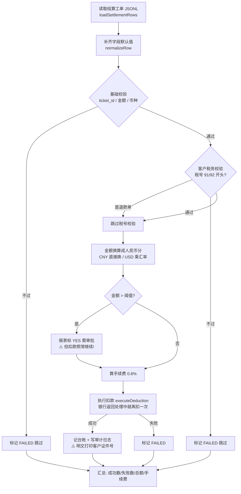

# Day 10 棕地侦察报告：星辰集团遗留财务结算脚本逆向审计

> 侦探模式：AI 逆向侦察（只看不改）
> 对象：`scripts/day10-brownfield-lab/legacy-settlement.mjs`（763 行，无文档，最后可考维护记录 2024-03）
> 数据集：`scripts/day10-brownfield-lab/data/settlements_dirty.jsonl`（14 张工单，全部为**虚构演示数据**）
> 结论速览：**这脚本不能碰生产，5 颗地雷全部实锤，其中 2 颗会直接造成资金损失。**

---

## 一、这脚本到底是干嘛的？（大白话版业务流程图）

剥掉 763 行代码的皮，它干的事其实只有一句话：
**「读一沓结算工单 → 算成人民币 → 标记大额 → 从客户账上扣钱 → 记台账」**。



人话总结每一步：

| 步骤 | 代码位置（函数） | 干什么 |
|---|---|---|
| 读数据 | `loadSettlementRows` | 一行行读 JSONL，坏行打条警告就跳过 |
| 洗数据 | `normalizeRow` | 缺字段补默认值，但**税号和汇率故意不兜底**（历史行为） |
| 校验 | `validateRow` + `validateCustomer` | 检查工单号/金额/币种，税号必须 91（企业）或 92（个体户）开头 |
| 换汇 | `yuanToCents` / `convertToCNY` | 一律换算成「分」入库，外币乘汇率 |
| 审批 | `checkApproval` | 金额超阈值就在报表标 YES——**仅标记，不拦截** |
| 扣款 | `executeDeduction` | 调银行网关，返回「处理中」就**再扣一次**直到成功 |
| 记账 | `ledgerLine` / `writeReport` | 拼 CSV 报表；审计日志只打在终端，不落盘 |

**结构判定**：脚本本体逻辑还算完整（校验→换汇→扣款→台账的骨架是对的），坏在细节里埋了雷，且没有任何测试兜底——这是最典型的「敢用但不敢改」棕地形态。

---

## 二、5 颗地雷定位（行号为重构前原始版本行号）

### 💣 地雷 #1：2025 已废止的「10 万」旧审批阈值硬编码
- **藏身处**：[legacy-settlement.mjs L26](file:///d:/Users/frankfeny/Desktop/ORRIX%20WorkBot/scripts/day10-brownfield-lab/legacy-settlement.mjs#L26)
  ```js
  const LEGACY_APPROVAL_THRESHOLD = 100000;
  ```
- **大白话**：代码里写死了「超 10 万才标审批」，注释还言之凿凿「老板说的勿动」。但 2025 年旧制度已废止，现行 FIN-001 是**单笔超 ¥50,000 必须强制人工审批**。
- **财务损失**：5 万~10 万之间的单子**全部漏审**。本数据集里 TCK-5003（¥52,800）、TCK-5009（¥50,001）都该触发 FIN-001 却纹丝不动。这是**合规红线级事故**——大额资金在没有具名审批人的情况下流了出去。另外它只「标记」不「拦截」，标完照样扣款，等于审批形同虚设。
- **实锤证据**：全量试跑中 TCK-5003（¥52,800）一路放行，状态 SETTLED，无任何审批标记。

### 💣 地雷 #2：重复扣款死循环（无幂等键 + while 重扣）
- **藏身处**：[legacy-settlement.mjs L347](file:///d:/Users/frankfeny/Desktop/ORRIX%20WorkBot/scripts/day10-brownfield-lab/legacy-settlement.mjs#L347)
  ```js
  while (result.state === 'PENDING') {
    result = gateway.charge(row.ticket_id, amountCents);
    chargeCount++;
  }
  ```
- **大白话**：银行第一次返回「处理中」很常见。老周的解决方案是：**循环再扣，直到成功**。致命的是：① 没传幂等键，每一轮都是一笔**全新的扣款指令**，银行根本不知道这是同一单；② 如果银行一直「处理中」（数据集 TCK-5007 的 STUCK 场景），循环**永不退出**——本次全量试跑就是活生生卡死在 TCK-5007，最后靠人工切断（Kill Switch）才停下来。
- **财务损失**：TCK-5004（$2,999 ≈ ¥21,740）实测连扣 **3 次**，客户被多扣两笔 ¥21,740，约 **¥43,480 需事后追退**。STUCK 场景下则是无限重复扣款 + 整个批处理队列被一个工单堵死，后面所有客户都结算不了。
- **附录 A 佐证**：脚本里自己记录的事故-01、事故-07，和这颗雷完全对得上——「当年运气好银行原路退回了」，运气不是每次都有。

### 💣 地雷 #3：汇率/金额精度浮点丢分（parseInt 截断）
- **藏身处**：[legacy-settlement.mjs L91](file:///d:/Users/frankfeny/Desktop/ORRIX%20WorkBot/scripts/day10-brownfield-lab/legacy-settlement.mjs#L91)（`yuanToCents`），同一手法复制在 L115（手续费）
  ```js
  return parseInt(String(yuan * 100), 10);
  ```
- **大白话**：换算成「分」时用 `parseInt` 直接**砍掉小数**，而不是四舍五入。浮点数乘法经常出现 `492938.8` 这种数，`parseInt` 一刀下去变 `492938`——**每一笔带小数的外币单都稳定丢 1 分钱**。注释里还振振有词「银行不差这几厘钱」。
- **财务损失**：单笔只丢 1 分，但这是**系统性少收**：数据集里 TCK-5002 实测结算 492,938 分，正确值是 492,939 分。按每天几十笔外币单、全年累积，月底对账永远差几块钱，财务被迫「手工调账」——附录 A 事故-02 就是它。
- **连带风险**：丢的虽是「分」，但**台账和银行流水永远对不平**，对账人力成本远大于丢的钱。

### 💣 地雷 #4：空税号直接崩溃（null 裸调 startsWith）
- **藏身处**：[legacy-settlement.mjs L258](file:///d:/Users/frankfeny/Desktop/ORRIX%20WorkBot/scripts/day10-brownfield-lab/legacy-settlement.mjs#L258)
  ```js
  const isCorp = row.tax_id.startsWith('91');
  ```
- **大白话**：税号字段如果是 `null`（数据源常见），这行直接抛 `TypeError: Cannot read properties of null (reading 'startsWith')`。虽然整批有 try/catch 兜底不至于全崩，但结果是**该工单被静默跳过**：只打一行 ERROR 日志，没有告警、没有重试队列、没有人工跟进清单。
- **财务损失**：TCK-5005（¥8,600）实测被静默丢弃——**客户的结算款凭空消失**，要等客户自己找上门才发现（附录 A 事故-04 原文重现）。数据集里还有 TCK-5011 空字符串税号 `""`，走的是另一条歧路：被误判为「税号异常」拒绝，同样是漏结算。

### 💣 地雷 #5：未脱敏身份证号写进日志
- **藏身处**：[legacy-settlement.mjs L441](file:///d:/Users/frankfeny/Desktop/ORRIX%20WorkBot/scripts/day10-brownfield-lab/legacy-settlement.mjs#L441)
  ```js
  logInfo('结算客户 ' + row.customer_name + ' 证件号 ' + row.id_number + ' 金额 ' + ...);
  ```
- **大白话**：每张工单处理时，客户**18 位身份证号原样打满整个终端日志**（`330104199003072218` 这样）。脚本作者小吴的理由是「排查对账问题一眼对上人」。
- **财务/合规损失**：违反 PII 脱敏红线（`3301 **** **** 2218` 才是合法形态）。终端日志会被截图、转发、进工单系统——本次试跑输出里 14 张工单的证件号全部裸奔。属于**合规审计直接挂项**，泄漏后还涉及个人信息保护责任。
- **实锤证据**：本次全量试跑每行「结算客户 XXX 证件号 XXXXXXXXXX」均为明文。

---

## 三、顺藤摸瓜的补充发现（不算 5 颗雷，但同样危险）

1. **审批不拦截**（L597 附近）：`needsApproval` 只是往报表写个 YES，扣款照常执行——「AI 只起草、放行归人」的红区纪律在遗留系统里完全不存在。
2. **无幂等键**：扣款指令只有 ticket_id 和金额，银行侧无法去重，是地雷 #2 的放大器。
3. **审计日志不落盘**（L113~L133）：`auditTrail` 只存内存 + 打终端，进程一断证据全无，违反「日志只增不改且全程留痕」。
4. **汇率兜底值过期**（L40）：没汇率时按 2023-03 的 `6.8912` 算，一年前的牌价，汇率波动大时误差可观。
5. **VIP 费率减免写了一半注释掉**（L121~L124）：VIP 客户按标准费率多收钱，靠「月底人工调整」三年。
6. **大量尸体代码**（L646~L763）：6 个历史版本函数不敢删，后来者根本分不清哪个在跑。

---

## 四、修复方案与回归测试设计（先红后绿）

### 测试策略
- **测试框架**：Node 22 内置 `node:test`，零第三方依赖（与 Day 9 三层记忆测试同口径）。
- **先写 5 条必然失败的回归测试**（每条钉死一颗地雷），另加 3 条「重构前后都必须绿」的基线用例证明零回归：
  1. **FIN-001 阈值**：¥52,800 必须触发审批、¥50,001 必须触发、¥50,000（等于）必须**不**触发。
  2. **重复扣款/死循环**：银行 HOLD 场景下扣款指令必须**恰好 1 次**；银行 STUCK 场景必须在有限步骤内安全终止（≥50 次调用即视为失控，测试桩直接引爆）。
  3. **汇率精度**：$680 × 7.2491 必须等于 492,939 分（四舍五入），不得丢分。
  4. **空税号**：`tax_id: null` 不得崩溃，工单进入「待补税号」人工清单，且**绝不扣款**。
  5. **日志脱敏**：所有日志行不得出现 15 位以上连续数字（身份证/完整税号），必须为掩码形态。

### 修复动作（对应 5 颗雷）
| 雷号 | 修复动作 |
|---|---|
| #1 | 阈值改为 `FIN001_APPROVAL_THRESHOLD = 50000`，注释引用现行 FIN-001，明确标注 2025 旧制度已废止；超阈值工单**停扣款、出审批单** |
| #2 | 扣款改为**单次指令 + 幂等键**（`ticket_id:结算日`），银行「处理中」只轮询状态、绝不重扣；轮询设上限，超限转人工 |
| #3 | 全部金额换算统一 `Math.round(x * 100)` 四舍五入，消灭 parseInt 截断 |
| #4 | 税号先做空值防御：null/空串/非法均进入 `SKIPPED_BAD_TAX_ID` 人工清单，永不崩溃、永不扣款 |
| #5 | 新增 `maskIdNumber` 脱敏函数，所有日志出口（INFO/WARN/ERROR）统一过脱敏 |

---

## 五、验证结果（重构后回填，2026-11-26）

> 状态：✅ 拆雷完成，先红后绿闭环达成。

### 回归测试（Node 22 内置 test runner，零第三方依赖）
| 阶段 | 结果 |
|---|---|
| 重构前（对遗留代码） | tests 8 / pass 3 / **fail 5** —— 5 条地雷用例全部命中失败，基线 3 条绿 |
| 重构后（v4 安全重构） | tests 8 / **pass 8 / fail 0** —— 地雷 5 条转绿，基线 3 条保持绿，零回归 |

### 端到端结算演示（同一批 14 张脏工单，前后对照）
| 工单 | 重构前行为 | 重构后行为 |
|---|---|---|
| TCK-5003（¥52,800） | 超 5 万无审批标记，直接扣款 | **FIN-001 触发，停止扣款，出审批单 AP-20261126-TCK-5003 转具名审批人** |
| TCK-5009（¥50,001） | 同上漏审 | 同上转人工审批（边界 +1 元正确触发） |
| TCK-5008（¥50,000 整） | — | 正常结算（「超过」才触发，等于不触发 ✓） |
| TCK-5004（HOLD） | **连扣 3 次**（重复扣款） | 单次扣款指令 + 幂等键，轮询确认后 SETTLED |
| TCK-5007（STUCK） | **死循环卡死整批**，靠人工切断 | 单次扣款 + 轮询上限，安全转人工跟进，整批继续 |
| TCK-5002 / TCK-5007（换汇） | 492,938 / 108,736 分（截断丢分） | 492,939 / 108,737 分（四舍五入不丢分） |
| TCK-5005 / TCK-5011（税号缺失/空串） | 静默崩溃跳过，¥8,600 结算款凭空消失 | 转人工补录清单，不崩溃、不扣款 |
| 全部 14 单 | 证件号明文裸奔 | 全部掩码（如 `330104********2218`） |

### 汇总口径
- 成功 8 / FIN-001 待人工审批 3 / 税号转人工补录 2 / 银行积压转人工 1，**无静默丢失**。
- `pnpm exec tsc --noEmit` 零错误；重构后脚本 813 行（含 v4 修复注释与补全的银行查询接口）。
- 演练全程遵守红线：无自动打款通道（超阈值一律挂起人工）、无正式数据写入（全部虚构数据 + 本地仿真网关）、卡死进程 5 秒内人工切断且日志留痕。
