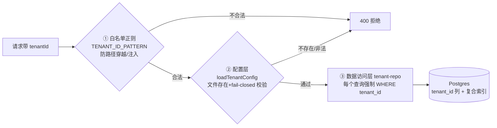

# Day 27–28 · Ontology 业务本体与配置优先底座（.fde/day27-ontology-map.md）

> 效力：承接 `AGENTS.md` 三区权限红线与 `brain/DOMAIN-XINGCHEN.md`；本文档是 WorkBot 业务本体的契约图示。
> 代码真源：`src/lib/ontology/`（types / schema / tenant-config / tenant-repo）。
> 冲突裁决：`AGENTS.md` > `.fde/01~05` > 本文档。

---

## 一、对象类型：单据 / 实体 / 政策

WorkBot 的业务世界由三类对象组成（定义见 `src/lib/ontology/types.ts`，注册表见 `schema.ts`）：

| 大类 | 对象 | 业务主键 | 落库表 | PII 字段（展示层脱敏） |
|---|---|---|---|---|
| **单据**（document） | 异常工单 ticket | ticketNo | `intake_requests` | 客户姓名、银行账号 |
| | 老 ERP 抓取副本 scraped_invoice | invoiceNo | `erp_scraped_invoices` | — |
| | 审批流运行 workflow_run | runId | `workflow_runs` | 客户姓名 |
| **实体**（entity） | 客户 customer / 供应商 supplier / 部门 department / 具名审批人 approver | — | 概念对象，字段寄居在单据表 | 客户姓名、银行账号 |
| **政策**（policy） | 制度文档 policy_doc | docNo | 概念对象（检索池 `[DOC-XX §X.X]`） | — |
| | 提示词口径 prompt_policy | version | 开关在 `prompt_versions` 表，文案真源在租户配置 | — |

**铁律**：所有持久化对象强制声明 `tenant_column: "tenant_id"`（Day 27 多租户逻辑隔离的物理前提），启动自检 `assertOntologyHealthy()` 逐条校验，缺列声明即拒绝启动。

---

## 二、星辰集团业务对象关系图

```mermaid
erDiagram
    CUSTOMER ||--o{ TICKET : "属于（n-1）"
    DEPARTMENT ||--o{ TICKET : "归属处理（n-1）"
    APPROVER |o--o{ TICKET : "人工放行（FIN-001）"
    POLICY_DOC }o--o{ TICKET : "引用依据 [DOC-XX §X.X]"
    SCRAPED_INVOICE }o--|| TICKET : "佐证（只读副本）"
    WORKFLOW_RUN ||--|| TICKET : "复核（1-1）"
    POLICY_DOC }o--o| POLICY_DOC : "废止链（旧规只当资料）"
    SUPPLIER ||--o{ SCRAPED_INVOICE : "供货（虚构演示数据）"

    TICKET {
        string ticketNo PK "工单编号 T-2026-XXXX"
        string tenant_id FK "租户（逻辑隔离）"
        string department "归属部门"
        int amount "金额（元）"
        string customerName PII "客户姓名→张*"
        string bankAccount PII "银行账号→6222****1234"
        bool is_fin001 "FIN-001 触发标记"
    }
    WORKFLOW_RUN {
        string runId PK "WF-YYYYMMDD-XXXX"
        string tenant_id FK "租户（逻辑隔离）"
        string phase "queued/invalid/awaiting_approval/completed"
        bool is_fin001 "大额强制人工审批"
    }
    SCRAPED_INVOICE {
        string invoiceNo PK "INV-2026-XXXX"
        string tenant_id FK "租户（逻辑隔离）"
        int daysOverdue "超期天数"
    }
    CUSTOMER {
        string customerId PK "寄居在单据表"
        string name PII "展示层脱敏"
    }
    APPROVER {
        string approverName PK "具名在职审批人"
        string note "AI/匿名/值班一律无效"
    }
    DEPARTMENT {
        string departmentName PK "清单来自租户配置"
    }
    POLICY_DOC {
        string docNo PK "[DOC-XX §X.X] 引文对象"
        bool abolished "已废止→物理剔除检索池"
    }
```

读法（一句话）：**客户**把异常交给某个**部门**形成**工单**；工单挂上**制度文档**作为处理依据；老 ERP 抓取副本作为只读佐证；审批流运行对工单做算术校验与挂起；跨过审批红线（FIN-001）的单据最终只能由**具名审批人**签字放行。

---

## 三、受控动作：注册表闭合（本体级 Kill Switch）

动作注册表**只有三种**（`ONTOLOGY_ACTIONS`），任何第四种动作在注册期直接抛错拒启动；`assertOntologyHealthy()` 还会对全部 kind/label 做「自动打款」类禁词扫描：

| 动作 | 分区 | AI 可自主执行 | 放行前提 | 对应现状 |
|---|---|---|---|---|
| `read_only_query` 只读查询 | 绿区 | ✅ | 无 | 只读快照工具、制度检索（结论必须带引文） |
| `dry_run_draft` 黄区预演 | 黄区 | ❌（必须人类确认） | human_confirmation | 后端锁死 `dryRun: true`，只出 Diff 草稿卡 + 审批单号 |
| `manual_release` 人工放行 | 红区边缘 | ❌ 永远 | named_approver + audit_log | FIN-001 具名签字放行，全站不存在 AI 打款按钮 |

> 自检红线：黄区/红区动作若被标记为 AI 自主执行、或人工放行缺失 `named_approver` 前提，进程拒绝启动。

---

## 四、配置优先底座：租户配置文件是唯一真源

Day 27 起以下四类内容**全部**从 `config/tenants/<tenantId>.json` 动态读取，代码里不再写死「星辰集团」：

| 配置项 | 字段 | 消费端 |
|---|---|---|
| 提示词模板 | `promptTemplate`（含 `{company}` `{threshold}` `{approvers}` 占位符） | `/api/chat` 稳定版提示词（`buildSystemPrompt`）；故障演练版文案留在 DB（演练语义不变） |
| 审批门槛 | `approvalThreshold`（department + amountYuan + mode:"above"） | `isLargeAmount` 租户规则注入、`/api/tickets` POST、审批流引擎 |
| 部门分类 | `departments` / `flowDepartments` | 工单提交校验、语义记忆部门学习 |
| 单据字段 | `documentFields`（key/label/required/pii） | 工单必填校验、PII 脱敏字段口径 |

**内置租户**：`xingchen`（星辰跨境企服集团，门槛 ¥50,000）与 `huayang-demo`（华洋国际贸易，虚构演示租户，门槛 ¥30,000，用于隔离测试）。

**fail-closed 校验**（`parseTenantConfig`）：门槛必须正整数且 mode="above"（严格大于，等于不触发——FIN-001 口径不可被配置弱化）；flowDepartments 不准指向未注册部门；正式提示词模板必须含 `{company}` `{threshold}` 占位符；任何非法配置直接抛错拒绝服务，绝不静默兜底。

**与 Day 26 审批策略的关系**：`config/approval-policies.json` 是全站策略规则（含默认租户门槛锚定 50000，代码基准一致性校验 fail-closed）；`config/tenants/*.json` 是多租户差异化配置。默认租户两者恒一致；其他租户只走租户配置。

---

## 五、多租户逻辑隔离：三层防线



1. **入口白名单**：tenantId 必须匹配 `^[a-z0-9][a-z0-9-]{1,63}$`，路径穿越形态直接拒绝。
2. **配置层**：`loadTenantConfig(tenantId)` 读 `config/tenants/<id>.json`，文件名与内容 tenantId 不一致即拒绝。
3. **数据层**：工单类单据的读写唯一入口是 `src/lib/ontology/tenant-repo.ts`——每个查询强制 `WHERE tenant_id = :tenantId`，调用方拿不到「不带租户条件」的查询入口；`tenant_id` 由写入层注入，调用方无法篡改归属。
4. **存量兼容**：四张业务表（`intake_requests` / `approval_audit_logs` / `workflow_runs` / `erp_scraped_invoices`）幂等增量迁移补 `tenant_id` 列，存量行回填默认租户 `xingchen`，既有单租户行为完全不变。

---

## 六、隔离验收（tests/tenant-isolation.test.ts，10 用例全绿）

- **注册表闭合**：受控动作恰好三种；`auto_pay` 类动作注册不进去；所有持久化对象声明 tenant 列。
- **配置动态读取**：两租户公司名/门槛/部门/字段标签全部来自各自文件；提示词渲染跨租户零串味（A 的提示词不出现 B 的公司名，反之亦然）；同一笔 ¥35,000 在华洋（门槛 3 万）触发 FIN-001、在星辰（门槛 5 万）不触发；等于门槛不触发在任意租户成立。
- **fail-closed**：不存在的租户、路径穿越、mode 非"above"、flowDepartments 指向未注册部门——全部拒绝。
- **数据库隔离**：租户 A 的全量列表绝无租户 B 的单据；拿 B 的单号到 A 查 → 查无此单；同一笔金额按各租户门槛落库 `is_fin001` 标记互不相同；测试夹具自动清理。

## 七、Non-Goals（本日不做）

- 不做租户级 schema 物理隔离（`schema-per-tenant`）——V1 只做 `tenant_id` 逻辑隔离；
- 不做租户自助注册/计费/配额——租户配置文件由运维手工放置；
- `prompt_versions` 表仍为全站版本开关（版本号/激活/演练标记），租户化版本管理留给后续迭代；
- 不改动老 ERP 抓取与提交链路的既有行为（仅补租户归属列）。
